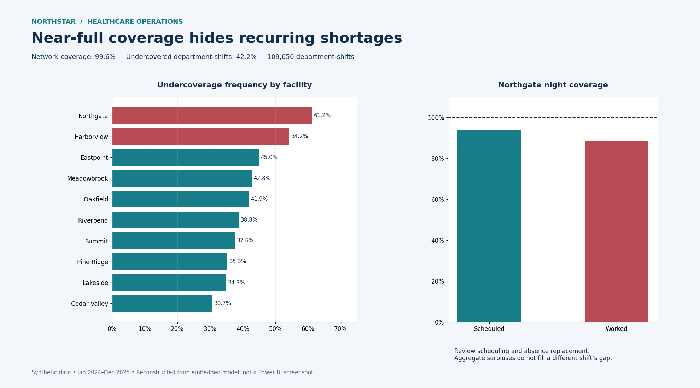
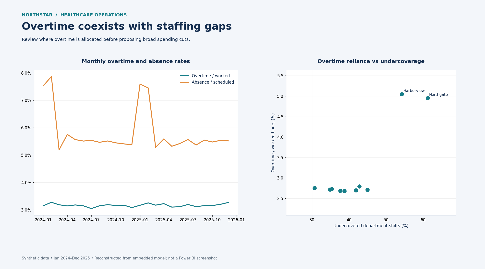
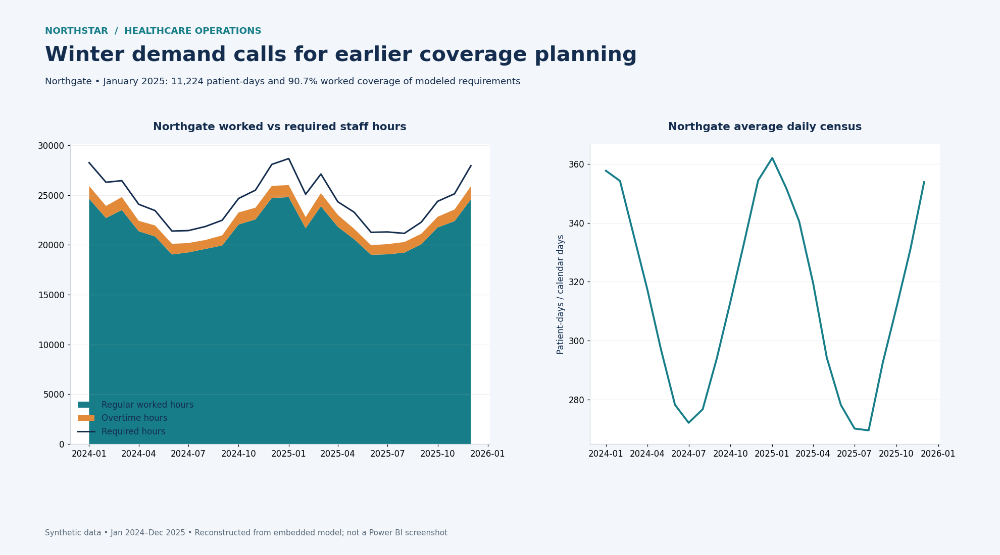
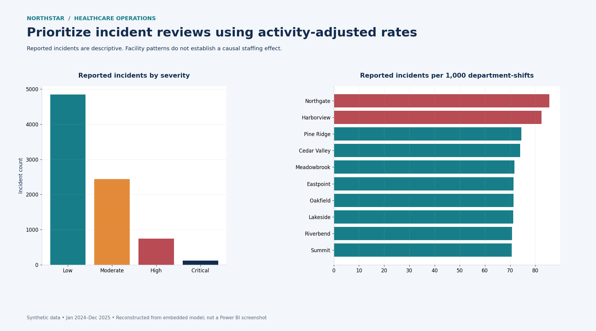

# Northstar Healthcare Operations

**Power BI portfolio project | Kalema Richard**  
Staffing coverage, overtime, patient demand, and operational incidents across **10 fictional healthcare facilities**, January 2024–December 2025.

> **Decision:** Prioritize staffing reviews at Northgate and Harborview. Network coverage of **99.6%** hides shortages on **42.2% of department-shifts**. Review scheduling, absence replacement, and overtime allocation before proposing broad spending cuts.

**All data is synthetic.** This is an analytical case study, not a clinical staffing assessment or evidence of real organizational performance.

[Download the Power BI report](report/Northstar_Healthcare_Operations.pbix) · [Opening and refresh instructions](docs/SETUP.md) · [Presentation talk track](docs/PRESENTATION.md) · [Metric definitions](docs/METRICS.md)

## Business questions

1. Which facilities, departments, and shifts should management prioritize for a staffing review?
2. Where is overtime being used while staffing gaps persist?
3. When patient demand rises, does staffing coverage keep pace?
4. Where are reported incidents concentrated after accounting for department-shift activity?

## Findings and recommended actions

| Verified finding | Management implication |
|---|---|
| Network worked coverage is **99.6%**, but **42.2%** of department-shifts are undercovered. Gross uncovered hours total **317,508**. | Examine shortages at the department-shift level. Surplus hours elsewhere can hide local gaps in network averages. |
| Undercoverage occurs on **61.2%** of Northgate shifts and **54.2%** of Harborview shifts. | Start staffing reviews at these two facilities. |
| Northgate night coverage is **93.9% scheduled** and **88.5% worked**. | Investigate the scheduled shortfall and further losses between scheduled and worked hours. |
| Northgate and Harborview use overtime equivalent to about **5%** of worked hours while gaps persist. | Check whether overtime reaches the affected departments and shifts before reducing spending. |
| In January 2025, Northgate records **11,224 patient-days** and **90.7%** worked coverage. | Plan seasonal coverage and absence replacement before winter demand peaks. |
| Northgate and Harborview have the highest reported incident rates: **85.6** and **82.4** per 1,000 department-shifts. | Review severity, incident type, department, shift, and reporting practices. These patterns do not establish causation. |

Figures were independently recomputed from the embedded model. [Full facility results](docs/facility_metrics.csv) · [Exact metrics](docs/verified_metrics.json) · [Validation results](docs/validation.json)

## Visual preview

These previews are **reconstructed charts from the exported model data, not screenshots of the Power BI interface**. The PBIX contains the original four interactive report pages. Actual Power BI screenshots and a Desktop refresh check remain to be completed; see [release status](docs/RELEASE_STATUS.md).

### 1. Staffing Coverage Review


### 2. Overtime and Staffing Pressure


### 3. Patient Demand and Coverage


### 4. Operational Incidents



The largest table is stored as `data/fact_shift_assignments.csv.zip` to keep downloads manageable. Before refreshing Power BI, extract this ZIP into the same `data` folder so `fact_shift_assignments.csv` sits alongside the other CSVs. The Python analysis reads the ZIP directly.

## Data and model

The model has six business dimensions and four fact tables. Active relationships use many-to-one cardinality and single-direction filtering from dimensions to facts. Date, facility, and department connect all four facts; shift connects coverage, assignments, and incidents. Role and employee connect to assignments. See [relationships](model/relationships.csv) and the [data dictionary](docs/DATA_DICTIONARY.md).

| Table | Rows | Grain |
|---|---:|---|
| `dim_date` | 731 | Calendar date |
| `dim_facility` | 10 | Facility |
| `dim_department` | 5 | Department |
| `dim_shift` | 3 | Shift type |
| `dim_role` | 4 | Staff role |
| `dim_employee` | 1,750 | Synthetic employee |
| `fact_shift_coverage` | 109,650 | Date × facility × department × shift |
| `fact_shift_assignments` | 643,219 | Employee assignment |
| `fact_patient_demand_daily` | 36,550 | Date × facility × department |
| `fact_operational_incidents` | 8,153 | Reported incident |

The CSV files were recovered from the report's **loaded model**, not from the unavailable original CSV files. They reproduce loaded values but do not recover source-file formatting, ordering, or pre-load history. The DAX-calculated `Month Start` column is excluded from `dim_date.csv` because the report creates it itself. Internal automatic date tables are excluded.

## Technical work demonstrated

- Power BI report design around operational business questions.
- A dimensional model spanning staffing, demand, and incident facts.
- DAX measures for weighted coverage, gross shortages, overtime, absence, and activity-adjusted incident rates.
- Facility and shift comparisons that expose the limits of aggregate KPIs.
- Reproducible Python validation, data exports, and static charts added during portfolio packaging.

[Exact DAX measures](model/measures.dax) · [Calculated column](model/calculated_columns.dax) · [Portable Power Query examples](model/)

## Reproduce the checks and previews

Python 3.12 was used for packaging. From the repository root:

```bash
python -m pip install -r requirements.txt
python scripts/analyze.py
python scripts/render_previews.py
```

To re-extract the supplied PBIX, run `python scripts/extract_model.py` **before** the analysis, and let it finish. Extraction overwrites CSVs and model metadata. The validation checks cover unique keys, foreign keys, expected grains and row counts, assignment-to-coverage hour reconciliation, and selected headline claims. They do not execute DAX in Power BI or validate clinical assumptions.

## Limitations

- Staffing requirements are modeled estimates, not approved clinical staffing standards.
- Synthetic patterns may reflect generation assumptions. The original generator was not supplied.
- Coverage is a ratio of total worked to required hours, not an average of row-level coverage ratios.
- Uncovered hours sum positive gaps by department-shift; surpluses elsewhere do not cancel them.
- Patient-days are not unique patients. Incident rates use department-shifts, not patient exposure or care intensity.
- Reported incidents depend on reporting practices; the synthetic staffing-pressure flag is not causal evidence.
- Report annotations are static. Changing filters does not rewrite their stated full-period or January 2025 scope.
- The saved demand page selects Northgate. The staffing page's month-number slicer combines matching months across years; use an explicit year/date filter for year-specific comparisons.
- The original PBIX is preserved unchanged. Opening, refresh, rendering, and filter interaction in Power BI Desktop were not tested in this environment.

No license has been added on the author's behalf. Reuse permissions have not been specified.
